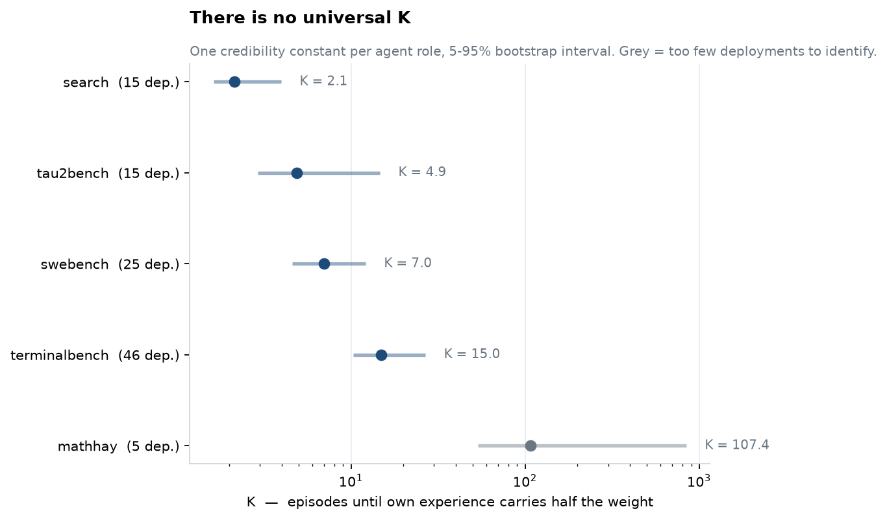
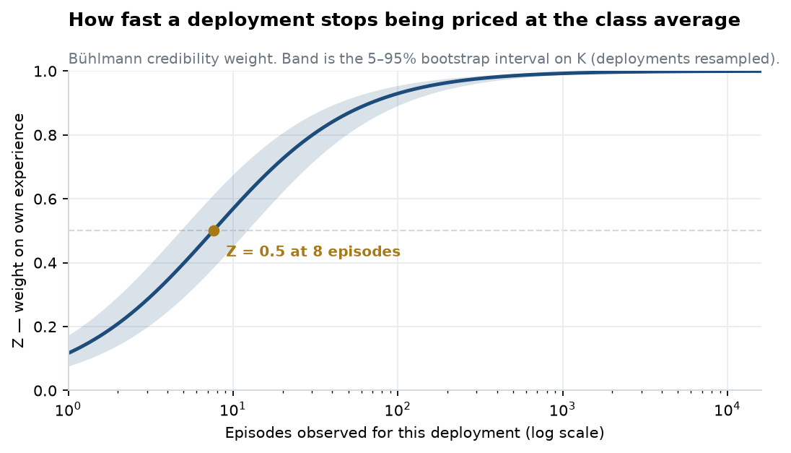
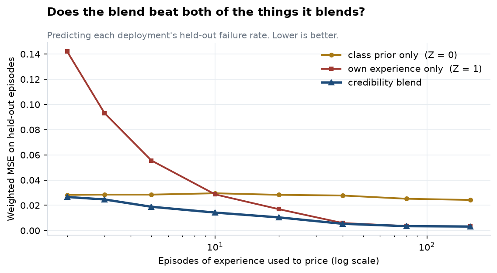
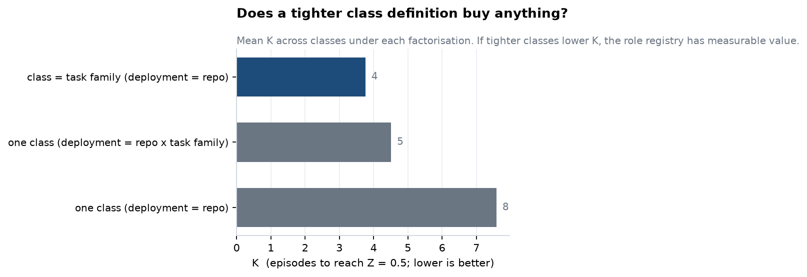
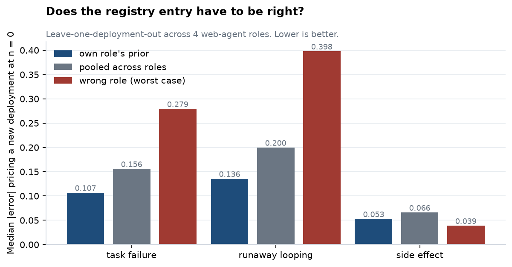
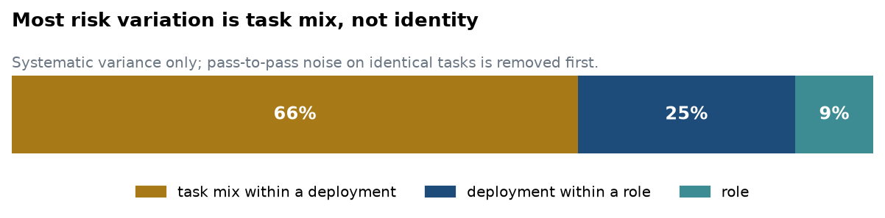

# agent-credibility

[](https://pypi.org/project/freeboard/)

Can you price an AI agent deployment that has little or no history of its own, by pooling
data from similar deployments? This repo tests that with Bühlmann credibility, the method
insurers use for thin experience data. It also contains the tooling that grew out of it:

- **freeboard**: a zero-dependency SDK that records agent episodes as privacy-safe counts
  (`pip install freeboard`)
- **the bureau**: a small server that pools those records and hands back a class prior
- **the severity lab**: experiments on how bad things get when an agent is attacked

Short answer: pooling works. The credibility constant for coding agents came out the same
on two unrelated datasets.

## Headline result

| | Dataset | Models | K | 5–95% |
|---|---|---|---:|---|
| coding agent | SWE-smith, 24,100 episodes | Claude 3.7 Sonnet | **7.6** | [4.8, 12.2] |
| coding agent | cx-cmu `swebench`, 613 episodes | DeepSeek, Qwen, Gemini | **7.0** | [4.6, 12.1] |

Different tasks, different scoring, different model families, and the estimates agree.
That points to K being a property of the agent's role, not of one dataset.



K differs a lot by role, from 2.1 for a research agent to 15.0 for an ops agent, so a K
without a role attached isn't useful.

## The idea in one formula

```
p̂ = Z · (own experience) + (1 − Z) · (class prior),    Z = n / (n + K)
```

`K = EPV / VHM` (within-deployment variance over between-deployment variance). If
deployments are all alike, K is huge, Z stays near zero and everyone gets priced at the
average. The experiment checks whether that happens. It doesn't.

Background: insurability research treats *monitored roles* as the insurable unit
([arXiv 2606.16465](https://arxiv.org/pdf/2606.16465)), and the
[*Underwriting the Agent Economy*](https://www.underwriting-agents.com/report.pdf) report
asks for frequency data while rejecting one-size-fits-all tables. Credibility sits between
the two.



## Results

### The blend beats both inputs



Predicting each deployment's held-out failure rate (weighted MSE):

| Episodes seen | Class prior only | Own data only | Credibility blend |
|---:|---:|---:|---:|
| 2 | 0.0282 | 0.1420 | **0.0266** |
| 5 | 0.0285 | 0.0555 | **0.0188** |
| 10 | 0.0295 | 0.0286 | **0.0142** |
| 20 | 0.0283 | 0.0169 | **0.0104** |
| 40 | 0.0277 | 0.0059 | **0.0053** |
| 160 | 0.0242 | 0.0032 | **0.0031** |

The blend wins at every size, by about 2x around n = 10–20. K has to be estimated from the
pool. Re-estimating it on each deployment's own small sample biases it low (2.2 at n = 2)
and makes the blend worse than the prior alone.

### The prior is worth about 8 episodes

Leave one deployment out and price it at n = 0 from the rest: median absolute error
0.1046. A deployment's own history needs 8 episodes to do as well. That lines up with
K = 7.6.

### Tighter classes lower K



Conditioning on task family takes mean K from 7.6 to 3.8. Scaffold doesn't help.

### Useful signals

`error_rate` (K = 5.9) and `n_turns` (K = 8.2) separate deployments. Action diversity
(`action_entropy` K = 30.7, `n_actions` K = 34.7) doesn't.

## Multiple roles

### Web agents (AgentRewardBench)

[AgentRewardBench](https://huggingface.co/datasets/McGill-NLP/agent-reward-bench): 4 web
environments x 4 models, 1,302 trajectories labelled by human experts, three loss types.

| Channel | Meaning | Base rate | Events |
|---|---|---:|---:|
| failure | task not done | 0.72 | 948 |
| looping | agent went in circles | 0.51 | 675 |
| side effect | changed something it shouldn't have | 0.065 | 87 |

Role explained about 54% of deployment-level variance for failure and looping, 22% for
side effects. Pricing with the wrong role's prior cost 2.6–2.9x in day-zero error.



| Channel | Own role prior | Pooled | Wrong role (avg) | Wrong role (worst) |
|---|---:|---:|---:|---:|
| failure | **0.107** | 0.156 | 0.191 | 0.279 |
| looping | **0.136** | 0.200 | 0.212 | 0.398 |
| side effect | 0.053 | 0.066 | 0.056 | 0.039 |

Side effects don't separate by role: only 87 events over 54 deployments. That's the
channel insurers care about most, and there isn't enough public data on it yet. At this
sample size K is only reliably recovered up to about 25, so these web numbers are
directional. Expert-vs-expert agreement was κ = 0.755 / 0.769 / 0.646, so about 11% of
failure labels are disputed.

### Six roles (cx-cmu/agent_trajectories)

[cx-cmu/agent_trajectories](https://huggingface.co/datasets/cx-cmu/agent_trajectories)
(gated): search, customer service, terminal ops, coding, MCP tools and maths across 5
models, 8,653 episodes. Each task is attempted up to four times by the same model, which
gives a clean read on run-to-run noise. `mcpbench` is excluded because its reward isn't
binary.

| Role | K | 5–95% | Deployments | Loss rate |
|---|---:|---|---:|---:|
| search | 2.1 | [1.6, 4.0] | 15 | 0.78 |
| tau2bench (customer service) | 4.9 | [2.9, 14.7] | 15 | 0.61 |
| swebench (coding) | 7.0 | [4.6, 12.1] | 25 | 0.78 |
| terminalbench (ops) | 15.0 | [10.3, 26.8] | 46 | 0.81 |
| mathhay | 107.4 | [53.6, 843.5] | 5 | 0.54 |

`mathhay` has too few deployments to pin down.

### Most variation is task mix



After removing run-to-run noise (0.0794):

| Level | Variance | Share |
|---|---:|---:|
| task mix within a deployment | 0.0765 | **65.7%** |
| deployment within a role | 0.0293 | 25.2% |
| role | 0.0106 | 9.1% |

This corrects the earlier 54% figure, which had no task level to attribute to. Most of
"this deployment is risky" is really "this deployment gets harder tasks". Credibility
still works at the task level (K = 2.96 [2.06, 4.98]), but pricing needs to account for
task mix, and a role registry alone isn't enough.

## freeboard (the SDK)

Stdlib only. Records each episode as counts and hashes. No prompts, outputs or raw ids
ever leave the process.

```bash
pip install freeboard
```

```python
from freeboard import Recorder, ToolSpec, Capability, Reversibility

rec = Recorder(
    deployment_id="acme-prod",
    role="customer_support",
    tools=[
        ToolSpec("search_orders",
                 capabilities=frozenset({Capability.PRIVATE_DATA}),
                 reversibility=Reversibility.REVERSIBLE),
        ToolSpec("issue_refund",
                 capabilities=frozenset({Capability.EXTERNAL_EFFECT}),
                 reversibility=Reversibility.IRREVERSIBLE),
    ],
    declared_capabilities={Capability.PRIVATE_DATA},   # cross-check only
)

with rec.episode(task_id="ticket-8821") as ep:
    ep.action("search_orders", output_chars=412)
    ep.action("issue_refund")
    ep.resolve(success=True)
```

`PYTHONPATH=src python examples/quickstart.py` runs a three-customer example end to end.

**Privacy.** The API has no free-text parameters (`output_chars` is a length). Ids are
salted and hashed per deployment. Tool names stay in-process. The wire format is an
allow-list and `validate()` runs on every record. `test_canary_never_reaches_the_wire`
pushes an SSN-shaped value through every input and checks it never shows up in the output.

A full record:

```json
{"deployment_id":"fdf3d47fa257542d","envelope_class":"C111-I0","episode_id":"a6b1be3e8c254f59",
 "error_rate":0.0,"escalated":false,"manifest_hash":"fa89b11ed297a47d",
 "max_reversibility":"irreversible","n_actions":6,"n_distinct_tools":3,"n_irreversible":1,
 "n_mutating":1,"observed_capabilities":["external_effect","private_data","untrusted_input"],
 "output_chars":4101,"pass_index":1,"repeat_rate":0.6,"resolved":true,"reward":null,
 "role":"customer_support","task_hash":"5ddb12eaa459eb73","tool_entropy":1.251629}
```

**Task envelope.** Scope is derived from the tools the agent is actually given, not from
what the customer declares. Derived, observed and declared scope are tracked separately,
and understating is weighted double. `class_code` (e.g. `C111-I0`) is based on
capabilities, so tools with different names but the same powers price the same. The
quickstart flags a rule-of-two violation: the agent can read untrusted input, reach
private data and issue irreversible refunds.

**Tamper evidence.** Records are hash-chained:

```
entry_hash(n) = sha256( prev_hash(n) || canonical_json(record without hashes) )
```

Deleting, editing or reordering a record is detectable, but only once the chain head is
checkpointed somewhere the writer can't rewrite (`Checkpoint`, or the bureau). There's a
test showing a rewritten chain passes self-verification and only the checkpoint catches it.

**Attestation.** The chain can't prove a record was true when written. An agent that can
hijack its own tool-call path can feed the recorder bad data. `ep.attest()` records an
independent count from outside the process (eBPF, an egress proxy, an audit log):

```python
with rec.episode("ticket-8821") as ep:
    ep.action("search_orders")
    ep.attest(actions_observed=5, source="ebpf")
    ep.resolve(success=True)
# unreported_actions = 4
```

**Sending to a bureau.** `BureauSink` writes to a local spool first and never raises into
the agent. If the bureau is down, records wait and deliver later.

```python
from freeboard import Recorder, BureauSink

sink = BureauSink("https://bureau.freeboardrisk.com",
                  spool="/var/lib/freeboard/acme.jsonl")
rec = Recorder(deployment_id="acme-prod", role="customer_support",
               tools=[...], sink=sink,
               state_path="/var/lib/freeboard/acme.state")

sink.flush()
print(sink.last_prior)
sink.anchor(rec.checkpoint())
```

`to_otel_attributes()` emits `gen_ai.*` and `agent.credibility.*` attributes for an
existing tracer, without an OTel dependency.

## The bureau

Running at `https://bureau.freeboardrisk.com`. Standard library and SQLite, behind a
Cloudflare tunnel with no inbound ports open.

```bash
curl https://bureau.freeboardrisk.com/v1/health
curl 'https://bureau.freeboardrisk.com/v1/priors?role=customer_support'
```

```
POST /v1/episodes     submit records, get your class prior back
POST /v1/checkpoints  anchor a chain head
GET  /v1/priors       a role's pooled prior
GET  /v1/divergence   normal level of unreported actions for a role
GET  /v1/health       counts
```

- **Admission.** Anyone can submit, but data only counts toward the pool after at least
  30 episodes, 3 hours of history, 2 checkpoints and an intact chain. Each contributor's
  weight is capped so no one holds a majority from three contributors on. This slows down
  poisoning. It can't stop it entirely.
- **Too-good-to-be-true check** (`bureau/anomaly.py`). For a Beta-Bernoulli class
  `K = a + b`, so a deployment's loss count is Beta-Binomial and you can ask how unlikely a
  record this clean is. It's a prompt to investigate, not a verdict, and a careful
  adversary can get around it.
- **Divergence baseline** (`bureau/divergence.py`). How many unreported actions are
  normal? Unattested episodes are excluded (not counted as zero) and different attestation
  sources are never mixed. The baseline is built leave-one-out. Including the deployment
  under test hides it: on a synthetic fleet, p went from 0.077 (not flagged) to 1.2e-14
  (flagged).
- **Storage.** Only validated wire records. Anything else is rejected.

## Envelope vs human labels (ATBench)

[ATBench](https://huggingface.co/datasets/AI45Research/ATBench) has 1,000 trajectories
with tool manifests and safety labels audited by five reviewers. Every tool there is
undeclared, so this is the worst case for the keyword fallback.

**Frequency: no signal.** Rule of two AUC 0.534, capability count 0.522, irreversible
tools 0.487, tool count 0.414 (inverse). About half the unsafe cases come from injection,
which is outside the manifest.

**Severity: real signal.** Among unsafe runs, structure predicts the kind of harm (tool
count p = 1.1e-10, η² = 0.116; capabilities p = 7.5e-05; irreversible tools p = 1.2e-04).

So `class_code` describes exposure and severity, not failure rate. Frequency has to come
from observed data.

## Severity lab

`src/lab/` measures how bad the outcome is given a hazard. It doesn't produce failure
rates on purpose (a test enforces that), because the workload is synthetic.

- **Three arms**: `constrained` (tool withheld), `baseline` (tool granted, no attack) and
  `exposed` (tool granted, attack present). The number that matters is exposed minus
  baseline.
- **Canary tools**: inert decoy tools. Which one an agent calls tells you what kind of
  mistake it made (name confusion, scope creep, borrowed authority). Canaries never count
  as harm.
- **Awareness**: each episode is scored on outcome and on whether the agent noticed the
  attack: defended, lucky, overwhelmed or oblivious.

Current numbers come from `SimulatedExecutor` with hand-set constants, so only the
structure is meaningful for now. Hazards follow Snyk's ToxicSkills audit.

## Validation

- The estimator is checked against the Beta-Bernoulli closed form (`K = a + b`) across
  three regimes and four seeds.
- A power analysis (`credibility/power.py`) shows K is recovered unbiased up to ~500 at the
  SWE-smith scale. 7.6 is well inside that.
- [docs/EVALUATING.md](docs/EVALUATING.md) lists the commands to check each claim.

## Limits

- SWE-smith is one agent and one model, so it measures differences between customers
  (repos), not roles.
- 82% of repeated tasks resolve the same way, so much of the variance is task difficulty.
- No timestamps, so drift isn't tested. The train/test split is a seeded shuffle.
- `resolved` stands in for a claimable loss. No dollar severity is modelled.
- The `xml` and `ticks` splits are mostly the same trajectories, so the analysis uses one
  scaffold at a time (K = 7.59 / 8.28 / 8.08).

## Running it

```bash
pip install -e ".[dev]" && pip install -r requirements-research.txt
pytest

python examples/quickstart.py                               # SDK, no network

python -m credibility.extract --out data/episodes.parquet   # ~45 min, streams 4.2 GB
python -m credibility.experiment --episodes data/episodes.parquet --out out
python -m credibility.role_separation --out out             # AgentRewardBench
python -m credibility.cx                                    # six roles (gated)
python -m credibility.atbench                               # envelope vs labels
python -m credibility.plots --out out

python -m bureau.app --db bureau.db --port 8080             # local bureau
```

Data: [`SWE-bench/SWE-smith-trajectories`](https://huggingface.co/datasets/SWE-bench/SWE-smith-trajectories).
Only per-episode counts, rates and entropies are extracted.

## Layout

| Path | What |
|---|---|
| `src/freeboard/` | the SDK (published to PyPI) |
| `src/bureau/` | the bureau server |
| `src/lab/` | severity lab |
| `src/credibility/` | research pipelines (not published, needs numpy/pandas) |
| `deploy/` | systemd units, installer, tunnel configs, backup script |
| `examples/quickstart.py` | SDK example |
| `out/` | results and figures |
| `tests/` | test suite |

## License

Apache-2.0
